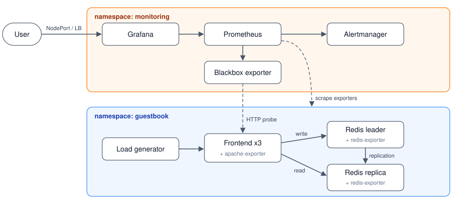
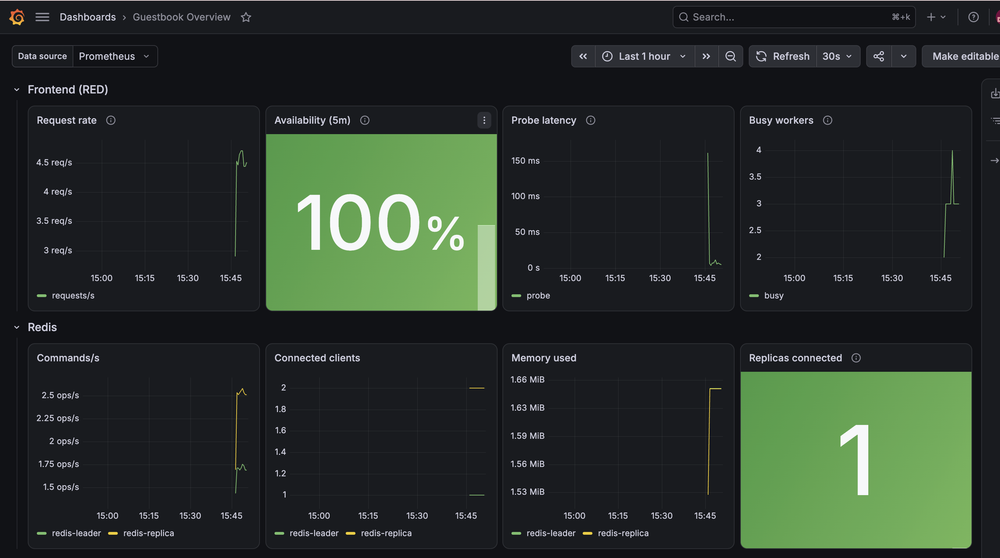
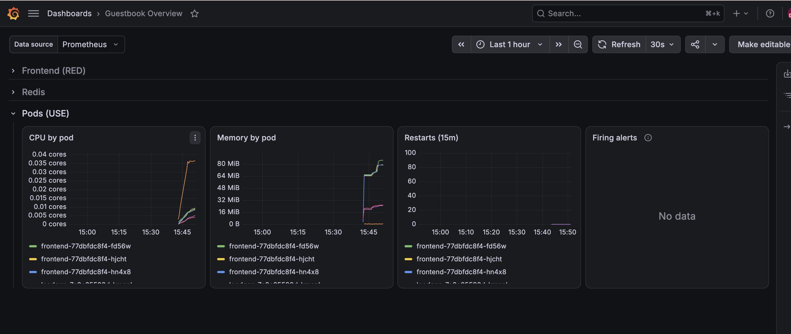

# Guestbook Monitoring

The Kubernetes Guestbook application deployed with Pulumi (TypeScript) and monitored with Prometheus and Grafana.

The application is based on Pulumi's [kubernetes-ts-guestbook](https://github.com/pulumi/examples/tree/master/kubernetes-ts-guestbook/components) example. On top of it, this project adds:

- Prometheus, Alertmanager and Grafana (kube-prometheus-stack Helm chart)
- Metrics exporters for the frontend and both Redis instances
- ServiceMonitors and an HTTP probe, so Prometheus scrapes the application
- Alert rules for the application
- A Grafana dashboard, provisioned as code
- A small load generator, so the graphs always have traffic

---

## Architecture



- The frontend writes to the Redis leader and reads from the Redis replica.
- Each guestbook pod runs a metrics exporter: Apache exporter on the frontend, Redis exporter on both Redis pods.
- ServiceMonitors tell Prometheus to scrape these exporters.
- The blackbox exporter probes the frontend over HTTP for availability and latency.
- Prometheus evaluates the alert rules and sends firing alerts to Alertmanager.
- Grafana reads from Prometheus and is exposed as a NodePort (minikube) or LoadBalancer (cloud).
- The load generator keeps steady traffic on the frontend.

### Project Structure

```
guestbook-monitoring/
├── index.ts                # Pulumi entry point and stack outputs
├── src/
│   ├── config.ts           # Stack configuration and defaults
│   ├── versions.ts         # Pinned Helm chart and image versions
│   ├── k8sjs.ts            # ServiceDeployment component (Deployment + Services)
│   ├── guestbook.ts        # Frontend, Redis leader/replica and exporter sidecars
│   ├── monitoring.ts       # kube-prometheus-stack and blackbox exporter releases
│   ├── scrape.ts           # ServiceMonitors and HTTP probe
│   ├── alerts.ts           # PrometheusRule
│   ├── dashboards.ts       # Grafana dashboard ConfigMap
│   ├── loadgen.ts          # Load generator
│   └── stack.ts            # Wires all components together
├── dashboards/             # Grafana dashboard JSON
├── imgs/                   # Architecture diagram and dashboard screenshots
├── scripts/                # Post-deploy verification script
├── tests/                  # Unit tests
├── Pulumi.yaml             # Pulumi project
└── Pulumi.dev.yaml         # minikube stack configuration
```

---

## Prerequisites

| Tool | Version | Install |
|---|---|---|
| Node.js | >= 20 | `brew install node` |
| Pulumi CLI | >= 3 | `brew install pulumi` |
| kubectl | match cluster version | `brew install kubectl` |
| minikube | latest | `brew install minikube` |
| Docker Desktop | latest | [docker.com](https://www.docker.com/products/docker-desktop) |
| jq | any | `brew install jq` |

The frontend image (`pulumi/guestbook-php-redis`) is only published for amd64. On Apple Silicon it runs under Docker Desktop's x86 emulation; enable "Use Rosetta for x86_64/amd64 emulation" in Docker Desktop settings.

---

## Deployment

### minikube

```bash
minikube start --cpus 4 --memory 6144

git clone https://github.com/Izanami-00/guestbook-monitoring.git guestbook-monitoring
cd guestbook-monitoring
npm install

export PULUMI_CONFIG_PASSPHRASE=<passphrase>
pulumi stack init dev
pulumi up
```

The project uses Pulumi's local backend (`file://~`), so no Pulumi Cloud account is needed. The passphrase encrypts the stack's secrets, such as the Grafana admin password.

The `dev` stack is pinned to the `minikube` kube context in `Pulumi.dev.yaml`.

The first deployment takes about 7 minutes.

### Cloud cluster (EKS / GKE / AKS)

With `kubectl` pointing at the cluster:

```bash
pulumi stack init prod
pulumi config set isMinikube false
pulumi config set kubernetes:context <context-name>
pulumi up
```

On a cloud cluster the frontend and Grafana are exposed through LoadBalancer Services.

### Configuration

| Key | Default | Description |
|---|---|---|
| `isMinikube` | `false` (`true` in `Pulumi.dev.yaml`) | `true` exposes Grafana as a NodePort; `false` uses LoadBalancer Services |
| `minikubeIp` | not set | If set, `grafanaUrl` is reported as `http://<minikubeIp>:<grafanaNodePort>` |
| `grafanaNodePort` | `30300` | Grafana NodePort, between 30000 and 32767 |
| `loadgenEnabled` | `true` | Deploy the load generator |

### Stack outputs

| Output | Description |
|---|---|
| `grafanaUrl` | Grafana URL (LoadBalancer address on cloud) |
| `grafanaAccessCommand` | Command that opens Grafana on minikube |
| `grafanaAdminUser` | Grafana admin user |
| `grafanaAdminPassword` | Grafana admin password (secret) |
| `frontendUrl` | Guestbook URL, or a port-forward command on minikube |
| `prometheusAccessCommand` | Port-forward command for the Prometheus UI |

---

## Grafana Access

| | minikube | Cloud |
|---|---|---|
| URL | `http://<minikube ip>:30300`, or run `minikube service kps-grafana -n monitoring --url` | `pulumi stack output grafanaUrl` |
| User | `admin` | `admin` |
| Password | `pulumi stack output grafanaAdminPassword --show-secrets` | same |

The admin password is randomly generated at deploy time and stored encrypted in the Pulumi stack. The chart's default password is not used.

With minikube's Docker driver on macOS, the node IP is not reachable from the host. Use `minikube service kps-grafana -n monitoring --url` instead. It prints a local URL and keeps a tunnel open while it runs.

The dashboard is under **Dashboards → Guestbook Overview**.

---

## Verifying that Prometheus scrapes the Guestbook

After `pulumi up` completes, wait about 3 minutes. Prometheus needs that long to load the new scrape configuration, and the load generator needs it to build up traffic.

### Verification script

```bash
./scripts/verify.sh
```

```
== Prometheus scrape targets
PASS  job frontend has 3 healthy target(s)
PASS  job redis-leader has 1 healthy target(s)
PASS  job redis-replica has 1 healthy target(s)
PASS  job frontend-probe has 1 healthy target(s)
== Guestbook metrics
PASS  frontend is serving requests (sum(apache_accesses_total{job="frontend"}) > 0 = 1837)
PASS  both redis instances are up (min(redis_up{namespace="guestbook"}) == 1 = 1)
PASS  replica is attached to the leader (redis_connected_slaves{job="redis-leader"} >= 1 = 1)
PASS  blackbox probe of the frontend passes (probe_success{job="frontend-probe"} == 1 = 1)
PASS  pod resource metrics are collected (count(container_memory_working_set_bytes{namespace="guestbook", container!=""}) >= 5 = 11)
PASS  kube-state-metrics sees the pods (count(kube_pod_info{namespace="guestbook"}) >= 5 = 6)
== Alert rules
PASS  guestbook.rules loaded with 8 rules
PASS  no guestbook alerts firing
== Grafana
PASS  Grafana is healthy
PASS  Guestbook Overview dashboard is provisioned

all checks passed
```

### Manual check

```bash
kubectl -n monitoring port-forward svc/kps-prometheus 9090
```

Open http://localhost:9090/targets. These targets should all be **UP**:

| Target | Job |
|---|---|
| `serviceMonitor/monitoring/frontend/0` | `frontend` (3 targets) |
| `serviceMonitor/monitoring/redis-leader/0` | `redis-leader` |
| `serviceMonitor/monitoring/redis-replica/0` | `redis-replica` |
| `probe/monitoring/frontend-probe` | `frontend-probe` |

Example queries for http://localhost:9090/graph:

```promql
sum(rate(apache_accesses_total{job="frontend"}[1m]))
redis_up{namespace="guestbook"}
redis_connected_slaves{job="redis-leader"}
probe_success{job="frontend-probe"}
```

---

## Metrics

| Area | Metrics |
|---|---|
| Frontend | Requests per second, busy and idle Apache workers, uptime |
| Availability | HTTP probe success and response time for the frontend Service |
| Redis | Up/down, commands per second, connected clients, memory used, connected replicas |
| Pods | CPU usage, memory usage, CPU throttling, container restarts |

---

## Dashboard

**Guestbook Overview** (`dashboards/guestbook-overview.json`) refreshes every 30 seconds.

| Row | Panels |
|---|---|
| Frontend | Request rate, Availability (5m), Probe latency, Busy workers |
| Redis | Commands/s, Connected clients, Memory used, Replicas connected |
| Pods | CPU by pod, Memory by pod, Restarts (15m), Firing alerts |

**Frontend and Redis**



**Pods**



---

## Alerts

| Alert | Condition | For | Severity |
|---|---|---|---|
| GuestbookFrontendScrapeDown | Frontend exporter cannot be scraped | 2m | critical |
| GuestbookFrontendProbeFailing | Frontend does not return HTTP 2xx | 2m | critical |
| GuestbookFrontendProbeSlow | Frontend takes more than 1s to respond | 5m | warning |
| GuestbookRedisDown | A Redis instance is down | 1m | critical |
| GuestbookRedisReplicationBroken | Redis leader has no connected replica | 5m | warning |
| GuestbookPodCrashLooping | More than 3 container restarts in 15 minutes | - | warning |
| GuestbookContainerMemoryHigh | Container above 90% of its memory limit | 5m | warning |
| GuestbookCPUThrottling | Container CPU-throttled in more than 25% of periods | 10m | warning |

To test an alert, stop the Redis replica:

```bash
kubectl -n guestbook scale deploy/redis-replica --replicas=0
# GuestbookRedisReplicationBroken fires after about 5 minutes
kubectl -n guestbook scale deploy/redis-replica --replicas=1
```

---

## Load Generator

The `loadgen` Deployment sends steady traffic to the frontend:

- every 0.5 seconds it loads the page and reads the guestbook entries
- every 5 seconds it writes a value

It writes to its own key, so entries added through the guestbook UI are not changed. To disable it:

```bash
pulumi config set loadgenEnabled false
pulumi up
```

---

## Tests

```bash
npm test               # unit tests, including the full program run against Pulumi mocks
npm run build          # TypeScript type check
```

---

## Clean Up

```bash
pulumi destroy
pulumi stack rm dev
minikube delete
```

---

## Future Improvements

- **Centralised logs with Loki**: Collect pod logs with Promtail or Grafana Alloy and send them to Loki. Logs can then be searched in Grafana next to the metrics.
- **Grafana users and teams**: Create separate teams for developers and SRE with folder permissions (Viewer for dev, Editor/Admin for SRE). Ideally sign in through SSO (Google, Azure AD or GitHub) instead of the shared admin account.
- **Alert notifications in Slack**: Configure Alertmanager to send alerts to Slack, with critical alerts going to an on-call channel and warnings to a team channel. Keep the webhook URL as a Pulumi secret.
- **Runbook and dashboard links on alerts**: Add `runbook_url` and `dashboard_url` to every alert, so the Slack message links straight to the fix steps and the right Grafana dashboard.
- **SLOs and burn-rate alerts**: Define an availability target for the frontend (for example 99.5%) and alert on how fast the error budget is being used, instead of on single failures.
- **Application-level metrics**: Add a Prometheus client library to the frontend to get request counts by HTTP status code and latency percentiles, which the Apache exporter does not provide.
- **Secure Grafana access**: Expose Grafana through an Ingress with TLS (cert-manager) instead of a NodePort or a public LoadBalancer.
- **Prometheus high availability**: Run 2 Prometheus replicas and 3 Alertmanager replicas. 
- **CI pipeline**: Run the unit tests, chart render checks and `pulumi preview` on every pull request, and deploy with `pulumi up` on merge.
